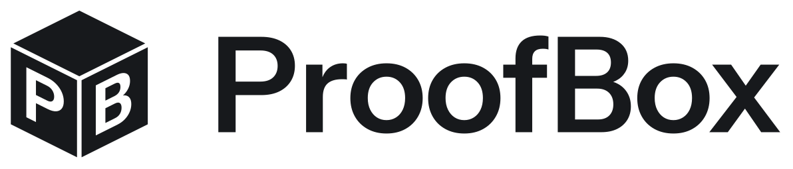

<p align="center">
  <picture>
    <source media="(prefers-color-scheme: dark)" srcset="docs/assets/proofbox-wordmark-white.svg">
    
  </picture>
</p>

<p align="center">
  Per-item packing proof for B2B fulfilment.<br>
  Built at Real-Time Video Agents Hack London, 17 Oct 2026.
</p>

<p align="center">
  <a href="https://proofbox.luis-markmann.workers.dev">proofbox.luis-markmann.workers.dev</a>
  ·
  <a href="https://github.com/lmarkmann/proofbox/actions/workflows/ci.yml"></a>
</p>

The packing station films each order, VAST video search finds every item going into the box, and the QR code on the printed label opens the proof: a disputed shipment comes with video of exactly what was packed.

## Demo

<p align="center">
  <a href="https://youtu.be/UgSbvmjAwKs">
    
  </a>
</p>

The demo video goes here.

## Team

| Name                 | Email                          |
| -------------------- | ------------------------------ |
| Hein Htet Phyo       | heinhtetphyo56@gmail.com       |
| Pavan Sidhu          | pavanssidhu@gmail.com          |
| Luis Camran Markmann | luis.camran.markmann@gmail.com |
| Riad Mc              | riadmc@proton.me               |

## Layout

| Path             | What                                                                               |
| ---------------- | ---------------------------------------------------------------------------------- |
| `apps/web`       | React app on Vite+ with Tailwind v4 and shadcn/ui (Base UI primitives, nova style) |
| `apps/api`       | FastAPI service on Python 3.14, managed by uv                                      |
| `apps/printer`   | local agent that renders box labels and prints them on a USB JADENS JD-268BT       |
| `apps/vision`    | local agent that detects the order's items in camera frames with YOLOE-26s         |
| `docs/assets`    | logo SVGs and `build_logo.py`, which generates them                                |
| `docs/vast`      | the VAST Builders Challenge guides and reference, copied from the organizers' repo |
| `.claude/skills` | the organizers' agent skills for the stack (search, ingest, VastDB, GPU models)    |

The skills load in both Claude Code and Cursor; `.cursor/rules/vast-builders.mdc`, symlinked into `.claude/rules`, holds the ground rules.

## Getting started

Install [pnpm](https://pnpm.io), [uv](https://docs.astral.sh/uv/), [just](https://just.systems) and [Vite+](https://viteplus.dev) (`vp`), then:

```sh
just setup   # pnpm install, uv sync, prek install
just dev     # API on :8000, printer agent on :8001, vision agent on :8002, web on :5173
just check   # format, lint, typecheck and test every app
just logo    # regenerate the logo into docs/assets and apps/web/public
```

Add UI components from `apps/web` with `pnpm dlx shadcn@latest add <component>`.

## Sign-in

The web app signs users in with WorkOS AuthKit (project `proofbox`) before it shows anything. `localhost:5173` uses the Staging environment and the deployed app uses Production, so an account in one does not exist in the other. The client IDs in `apps/web/src/main.tsx` are public and no API key is involved. Everyone in the team table has an account in both: sign in with your email and the code WorkOS sends, or with Google, Microsoft, GitHub or Apple.

A new origin (custom domain, another port) has to be added to the matching WorkOS environment as a redirect URI, CORS origin and logout URI, or sign-in fails.

## Deploy

Every push to `main` deploys the web app as the Cloudflare Worker `proofbox` at <https://proofbox.luis-markmann.workers.dev>: the `deploy` job in `.github/workflows/ci.yml` runs after the `linux` checks pass, in the GitHub environment `production`, with a Workers-scoped Cloudflare token in its `CLOUDFLARE_API_TOKEN` secret. To deploy by hand from a machine logged in with `wrangler login`:

```sh
vp run web#deploy   # build, then wrangler deploy
```

Only the web app is deployed. The API runs on the lab VM and the printer agent next to the printer, so on the Worker the header shows both as offline.

## Public proof links

A label's QR code opens `https://proofbox.luis-markmann.workers.dev/proof/<order>` on any phone, on mobile data. `/proof` is public and sits ahead of the WorkOS gate, so the person scanning needs no account.

The station runs on `localhost`, so tell its build where the QR codes should point:

```sh
cp apps/web/.env.example apps/web/.env.local   # VITE_PROOF_ORIGIN=https://proofbox.luis-markmann.workers.dev
```

Unset, labels point at the station's own origin, which no phone can reach.

The Worker serves the build and forwards four reads under `/api` to `API_ORIGIN`, the API's public URL, with the `Range` header passed through so the video seeks:

| Worker path                   | API path                  |
| ----------------------------- | ------------------------- |
| `GET /api/orders/{id}`        | `GET /orders/{id}`        |
| `GET /api/packs/{id}/video`   | `GET /packs/{id}/video`   |
| `GET /api/packs/{id}/track`   | `GET /packs/{id}/track`   |
| `GET /api/packs/{id}/summary` | `GET /packs/{id}/summary` |

Every other `/api` request gets a 404 from the Worker, so the public surface is read-only. Writes (opening and sealing packs, `/ask`, `/transcribe`) stay on the station, which reaches the API through the Vite dev proxy and the SSH tunnel that `just dev` opens. `apps/web/worker/public-api.ts` holds the allowlist.

The API reaches Cloudflare through an outbound `cloudflared` tunnel from the VM, no sudo needed. Until a named tunnel exists it is a quick tunnel, whose `*.trycloudflare.com` URL changes on every restart:

```sh
# on the VM: start it and read the URL it was given
nohup ~/bin/cloudflared tunnel --no-autoupdate --url http://localhost:8000 > ~/proofbox-tunnel.log 2>&1 < /dev/null &
echo $! > ~/proofbox-tunnel.pid
grep -o 'https://[a-z0-9-]*\.trycloudflare\.com' ~/proofbox-tunnel.log | head -1

# on the laptop: point the deployed Worker at it (a secret, so CI deploys keep it)
pnpm --dir apps/web exec wrangler secret put API_ORIGIN

# or try the Worker locally against it
pnpm --dir apps/web exec wrangler dev --port 8790 --var API_ORIGIN:https://<name>.trycloudflare.com
```

Until `API_ORIGIN` is set, the four reads answer 503 and the proof page says the API is unreachable. A quick tunnel exposes the whole API at an unguessable URL, writes included; the Worker's allowlist does not protect that URL.

If the VM cannot open a tunnel, `just tunnel` serves the local dev server on :5173 at a `*.trycloudflare.com` URL instead. Put that URL in `VITE_PROOF_ORIGIN` in `apps/web/.env.local` (Vite restarts on the change) and the labels open the proof page through the station's own proxy. That URL also exposes the station, so stop the tunnel after the demo.

## Bench camera

An iPhone works as the station's camera through Continuity Camera, with no app on the phone. It needs macOS Ventura or later and iOS 16 or later, both signed in to the same Apple ID, with Wi-Fi and Bluetooth on for both. Lock the phone and mount it stationary in landscape, looking down at the bench. Once you start the camera the phone shows up in the camera picker next to the Stop button, and the station picks it by default whenever it is connected. Your own pick is remembered in this browser. If the phone drops out mid-session the station switches to another camera and the picker shows which one; it switches back to the phone when it reconnects, unless you picked a different camera yourself.

For a demo without a live bench, put a clip in `apps/web/public/demo/` (gitignored) and open the station with `?replay=/demo/<file>.mp4`. It starts playing on load, muted and without controls, and stops on the last frame so a seal at the end of the clip lands like a real pack; add `&loop` to loop it. The panel looks the same as with the camera and the status strip says Replay. Paths outside `/demo/` are ignored.

## Label printer

The printer agent runs on the machine the printer is plugged into, separate from the API, so the API can live anywhere. It talks raw TSPL over USB through libusb, with no driver or CUPS queue. Load 4x6 in fanfold labels and hold the feed button until one beep so the printer measures them.

From the web app, call it through the dev proxy at `/printer`:

| Request                        | Does                                                                 |
| ------------------------------ | -------------------------------------------------------------------- |
| `GET /printer/health`          | `{"printer": "connected" \| "missing"}`                              |
| `POST /printer/labels/preview` | the label as a PNG, prints nothing                                   |
| `POST /printer/labels`         | prints one label; 503 if no printer, 409 if another process holds it |

Both POSTs take `{"order_id": "PB-20481", "proof_url": "https://...", "lines": ["3 items", "Acme GmbH"]}`: the order ID up to 40 characters, the URL the QR code opens, and up to three detail lines. Without the web app, post straight to the agent:

```sh
xh POST :8001/labels/preview order_id=PB-20481 proof_url=https://proofbox.app/p/demo > label.png
```

A browser tab that has opened the printer over WebUSB holds it until the tab closes; prints then fail with 409.

## Contributing

`main` is protected: work on a branch, open a PR, squash-merge it. CI (`linux`) runs format, lint, types, tests and a version drift check; on `main` it then deploys.

Every user-facing change gets a changeset: run `pnpm changeset`, pick `web` and the bump, write one sentence, commit it with the code. Merging to `main` opens a "chore: release" PR; merging that tags `vX.Y.Z`. There is one version for the whole repo, so never edit a version by hand.
